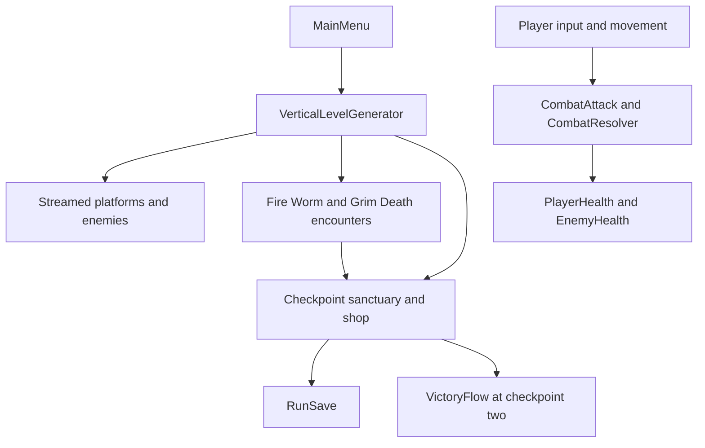

# Architecture and tuning

The game separates input/movement, combat resolution, health, encounters, procedural generation, persistence, and UI into Unity components. Scene/prefab references and ScriptableObject assets provide editable configuration.

| Area | Main code | Responsibility |
| --- | --- | --- |
| Movement/input | `Assets/Scripts/Character/Player/PlayerController.cs`, `Assets/Input/Player Actions.inputactions` | Movement, jumps, dash, facing, input bindings |
| Melee/parry/spell | `PlayerCombat.cs`, `PlayerParry.cs`, `PlayerSpell.cs` in the same Player folder | Player action timing and intent |
| Combat resolution | `Assets/Scripts/Character/Scripts/Combat/CombatAttack.cs`, `CombatResolver.cs` | Attack records, collision queries, one hit per target, trades, parry and pogo |
| Health/death | `Player/PlayerHealth.cs`, `Scripts/EnemyHealth.cs` under Character | Health, protection, damage feedback and death flow |
| Bosses | `Combat/FireWormBoss.cs`, `Combat/GrimDeath/` | Encounter state machines, attacks, summons, hazards, health bars and route seals |
| Generation | `Assets/Scripts/Terrain/VerticalLevelGenerator.cs`, `VerticalLayout.cs` | Seeded layouts, chunk streaming, enemy records, checkpoint progression |
| Checkpoint safety | `Assets/Scripts/Gameplay/CheckpointSanctuary.cs` | Clear nearby enemies/projectiles without farming rewards; protect resting players |
| Persistence | `Assets/Scripts/Gameplay/RunSave.cs` | JSON checkpoint snapshot, atomic replacement and backup recovery |
| Economy | `Gameplay/ShopMenu.cs`, `PlayerUpgrades.cs`, `ShopCatalog.cs` | Purchase validation and editable upgrade offers |
| UI/settings | `Assets/Scripts/UI/`, `Assets/Scripts/Settings/` | Menus, HUD, camera, active-device prompts, audio/accessibility and keybind preferences |
| Ending | `Assets/Scripts/Gameplay/VictoryFlow.cs`, `VictoryStage.cs` | Requires boss victories plus checkpoint two; freezes gameplay and runs an unscaled-time cinematic |

## Tuning without rewriting behavior

- `Assets/Settings/VerticalPillar.asset`: generation dimensions, platform/enemy prefabs, checkpoints, boss encounter references, and shopkeeper.
- `Assets/Settings/GrimDeath.asset`: health, scythe frames, recovery, dash/teleport timing, spell warnings, summon hover/hurtboxes, animation arrays and sound levels.
- `Assets/Settings/CombatSettings.asset`: shared melee timing and terrain collision mask.
- Player's **PlayerParry** component: startup/active/missed-recovery frames, successful protection and successful recovery.
- Camera's **CameraFollow** component: smoothing, safe region, look-ahead and boss zoom limits.
- ShopCatalog assets: price, upgrade amount, maximum purchases and presentation.

Combat frame values use a 60 FPS reference converted to seconds. A single enemy hit is tracked per attack. Grim Death caps each connecting player hit to one HP, independently of normal-enemy damage upgrades.

## Persistence and safety

Saves are local in `Application.persistentDataPath/run-save.json`; Settings and keybinds use PlayerPrefs. `run-save.json.bak` is the prior valid snapshot. New Run and a completed ending deliberately remove live/backup/temp save files. The cinematic retains the checkpoint save until its end card so an interrupted ending can be resumed.

This is a local single-player game, not a networked service. It does not require user accounts or store passwords. Save files are not an anti-cheat boundary. Generated folders, credentials and runtime user saves should never be committed.

## Efficiency and remaining code polish

Chunk and enemy streaming bounds the active world; reusable query lists and a bounded boss-hazard pool reduce repeated allocation. Profile a final build before making performance claims. Some encounter/generator methods remain densely formatted and use short variable names; a focused formatting/naming pass would improve readability. Avoid a broad gameplay refactor immediately before submission without time to revalidate it.
